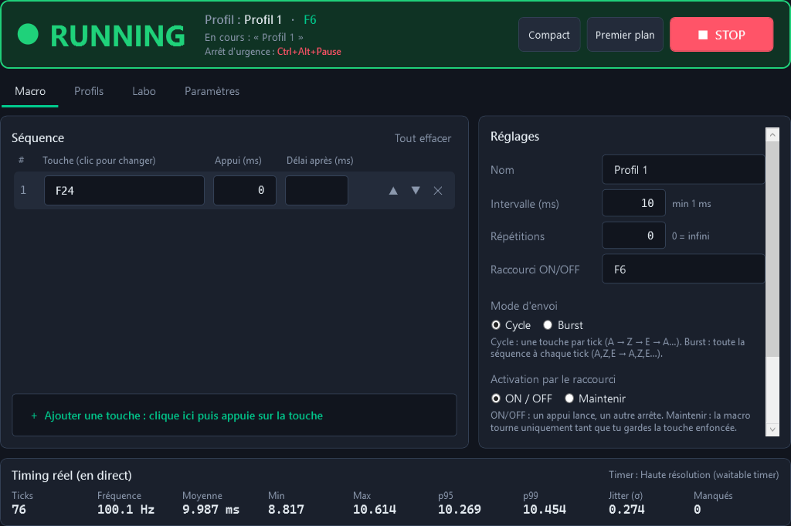
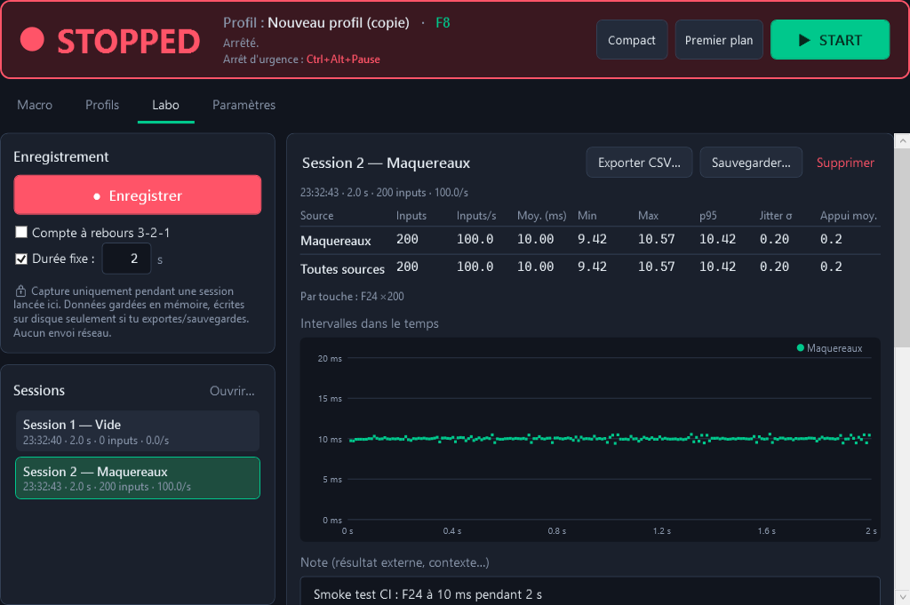
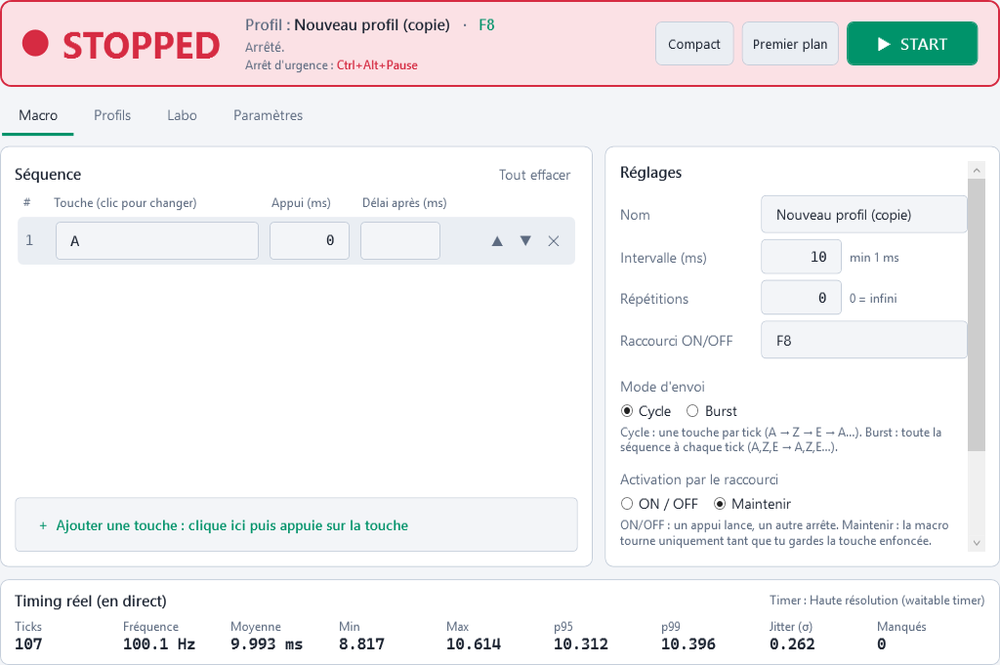
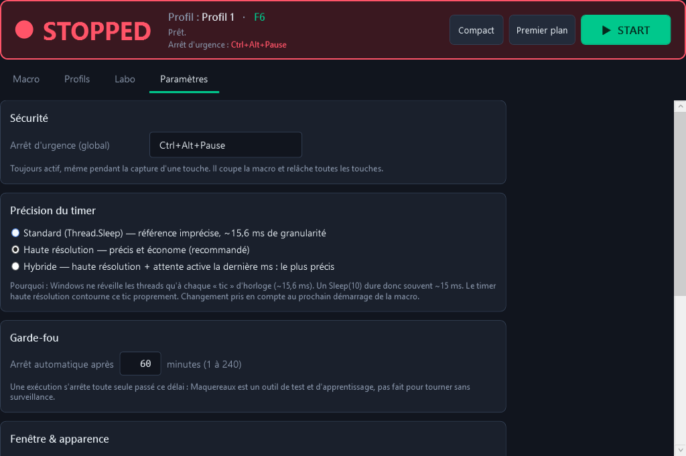

# 🐟 Maquereaux

**Auto-presser de touches pour Windows** : envoie une séquence de touches en boucle, à intervalle réglable
(**10 ms réels**, et même 1 ms), avec raccourcis globaux, profils, mode « maintenir », filtre de fenêtre et un
**labo de mesure** pour comparer objectivement ton timing manuel et celui de la macro.

Projet d'apprentissage (Win32, timers, threading, MVVM) — 100 % local, aucune télémétrie, aucune connexion réseau.



---

## 📥 Installation (30 secondes)

1. Onglet **[Releases](../../releases)** → télécharge **`Maquereaux.exe`** (dernière version).
2. Double-clic. C'est tout : exe autonome win-x64, **aucun .NET à installer**.
3. Windows SmartScreen peut afficher « Windows a protégé votre ordinateur » (l'exe n'est pas signé) :
   *Informations complémentaires* → *Exécuter quand même*.

Le fichier `Maquereaux.exe.sha256` joint à chaque release permet de vérifier l'intégrité :
```powershell
Get-FileHash .\Maquereaux.exe -Algorithm SHA256
```

Configuration requise : Windows 10 (1803+) ou 11, x64. Les profils et réglages sont dans `%AppData%\Maquereaux\`.

---

## 🚀 Utilisation rapide

1. Onglet **Macro** : clique sur « + Ajouter une touche » puis appuie sur la touche voulue (répète pour faire une séquence).
2. Règle l'**intervalle** (ms), le **mode** (Cycle = une touche par tick, Burst = toute la séquence à chaque tick)
   et le nombre de **répétitions** (0 = infini).
3. Place-toi dans l'appli cible et appuie sur **F6** pour lancer / arrêter.
4. **Ctrl+Alt+Pause** = arrêt d'urgence, toujours actif.

| Onglet | Ce qu'on y fait |
|---|---|
| **Macro** | Séquence (capture, réordonner, durée d'appui, délai par touche), intervalle, mode, répétitions, raccourci, ON/OFF ou **Maintenir**, **fenêtre cible**, stats de timing en direct |
| **Profils** | Plusieurs configurations, chacune avec son raccourci (F6, F7…) ; créer, renommer, dupliquer, supprimer, import/export JSON |
| **Labo** | Enregistre tes frappes (et celles de la macro) pendant N secondes, stats par source, graphique, comparaison A/B, export CSV |
| **Paramètres** | Arrêt d'urgence, précision du timer, garde-fou de durée, thème, zone de notification, droits admin |

<table>
<tr>
<td></td>
<td></td>
</tr>
<tr>
<td></td>
<td><br/></td>
</tr>
</table>

_Captures générées automatiquement par le smoke test de la CI sur un runner Windows._

### Fonctionnalités clés
- **Mode Maintenir** : la macro tourne uniquement tant que tu gardes la touche du raccourci enfoncée.
- **Fenêtre cible** : n'envoie des touches que si l'appli choisie (ex. `notepad.exe`) a le focus → pause automatique sinon.
  Évite de spammer Discord ou ton navigateur par erreur.
- **Anti-touche bloquée** : à l'arrêt (normal, urgence, fermeture, crash) toute touche enfoncée est relâchée.
- **Scan codes** : les touches sont envoyées comme un vrai clavier (position physique), résolues selon ta disposition (AZERTY/QWERTY).
- **Zone de notification** (pastille verte/orange/rouge), **mode compact** toujours au premier plan, **thème clair/sombre**.
- **Garde-fou** : arrêt automatique après N minutes (60 par défaut) — Maquereaux n'est pas fait pour tourner sans surveillance.

---

## ⏱️ Précision du timer

Par défaut, Windows ne réveille un thread qu'à chaque « tic » d'horloge (~15,6 ms) : un `Thread.Sleep(10)` dure souvent ~15 ms.
Maquereaux propose 3 stratégies (Paramètres → Précision du timer). Mesures réelles, 1 000 ticks par ligne, runner GitHub
Windows (VM 4 cœurs, Windows 10.0.26100), via le vrai moteur :

| Stratégie | Intervalle | Moyenne | Min | Max | p95 | p99 | Jitter (σ) | Manqués | CPU (1 cœur) |
|---|---:|---:|---:|---:|---:|---:|---:|---:|---:|
| Standard | 10 ms | 10.003 | 0.000 | 25.883 | 19.184 | 23.707 | 7.320 | 467 | 2.2 % |
| **HighResolution** (défaut) | 10 ms | **10.000** | 9.320 | 10.627 | **10.338** | 10.592 | 0.251 | 0 | 0.5 % |
| Hybrid | 10 ms | **10.000** | 7.858 | 13.041 | **10.001** | 10.008 | 0.124 | 0 | 4.7 % |
| HighResolution | 5 ms | 5.011 | 4.535 | 14.832 | 5.562 | 5.576 | 0.405 | 1 | 0.3 % |
| Hybrid | 5 ms | 5.000 | 4.984 | 5.016 | 5.001 | 5.003 | 0.001 | 0 | 9.4 % |
| HighResolution | 1 ms | 1.000 | 0.523 | 1.589 | 1.058 | 1.551 | 0.182 | 25 | 1.6 % |
| Hybrid | 1 ms | 1.000 | 0.982 | 1.018 | 1.000 | 1.002 | 0.001 | 0 | 100.0 % |

Comment lire ce tableau :
- **Standard** a une moyenne « parfaite » uniquement parce que le moteur vise des échéances absolues : il rattrape son retard
  (min 0 ms = deux ticks collés). En réalité le rythme est haché : p95 à 19 ms, 47 % d'échéances manquées.
- **HighResolution** (`CREATE_WAITABLE_TIMER_HIGH_RESOLUTION`) tient 10 ms à ±0,3 ms pour un CPU quasi nul → c'est le défaut.
- **Hybrid** (haute résolution puis attente active la dernière milliseconde) est d'une précision chirurgicale mais brûle du CPU :
  à 1 ms il occupe un cœur entier.

✅ Critère du cahier des charges (moyenne 9,8–10,2 ms et p95 ≤ 11 ms à 10 ms) : **atteint** par HighResolution et Hybrid.

Relancer les benchmarks : `dotnet test tests/Maquereaux.Win32.Tests -c Release --filter "Category=Benchmark"`
(chaque run CI publie aussi le tableau dans le résumé du job « Benchmarks timers »).

---

## 🧪 Labo de mesure

1. Onglet **Labo** → coche *Compte à rebours* et *Durée fixe 20 s* → **● Enregistrer**.
2. Tape dans ton appli pendant 20 s (session « Manuel »), puis refais une session en laissant tourner la macro (« Maquereaux »).
3. La comparaison A/B se remplit toute seule : inputs/s, intervalles (moyenne, min, max, p95, jitter), durée d'appui, graphiques.
4. Ajoute une **note** (ex. « mannequin, macro officielle, 20 s → 12 340 dégâts ») et **exporte en CSV** (lisible dans Excel FR/EN).

Chaque frappe est horodatée au `Stopwatch` (QueryPerformanceCounter) et classée par **source** : physique (toi),
Maquereaux (signature dans `dwExtraInfo`), ou autre logiciel injecté (`LLKHF_INJECTED`).

🔒 **Confidentialité** : la capture n'est active que pendant une session lancée à la main (indicateur ● REC dans le Labo
et dans le bandeau). Les données restent en mémoire et ne sont écrites sur disque que si tu exportes/sauvegardes.

---

## ⚠️ Limites connues

| Limite | Explication |
|---|---|
| **Applis lancées en administrateur** | Windows (UIPI) bloque les touches envoyées par une appli non-admin vers une appli admin. Maquereaux le détecte et propose de se relancer en admin (Paramètres). |
| **Jeux / anti-cheat qui ignorent les entrées injectées** | Les touches de Maquereaux portent le flag « injecté » de Windows. **C'est voulu et ne sera pas contourné** (voir Hors périmètre). |
| **Bureau sécurisé** | Écran de verrouillage, UAC, Ctrl+Alt+Suppr : impossible d'y envoyer des touches (protection Windows). |
| **Durée d'appui 0 ms** | Down et up partent dans le même `SendInput` : parfait pour les applis classiques. Certains jeux lisent l'état du clavier une fois par frame et peuvent « rater » l'appui → mets 5–20 ms d'appui. |
| **Touche Pause** | Pas de scan code rejouable : envoyée en mode VK (fonctionne dans la grande majorité des cas). |
| **Hybrid à 1–2 ms** | Occupe un cœur CPU à ~100 %. |
| **Exe non signé** | Avertissement SmartScreen au premier lancement. |

## 🚫 Hors périmètre (volontairement non implémenté)
Pas d'anti-détection (aucune « humanisation » aléatoire des délais, pas de masquage du flag d'injection, pas de pilote
noyau ni d'émulation matérielle), pas de contournement d'anti-cheat ni d'injection/lecture mémoire, pas de lecture d'écran
ou d'OCR pour décider des actions, pas d'automatisation longue durée sans présence, aucune communication réseau.

---

## 🛠️ Développement

Stack : **.NET 8**, **WPF**, MVVM avec `CommunityToolkit.Mvvm`, P/Invoke (`LibraryImport`), xUnit.

```text
src/Maquereaux.Core    logique pure (moteur, plan, stats, profils, labo) — aucune dépendance WPF/Win32, testable partout
src/Maquereaux.Win32   SendInput (scan codes), RegisterHotKey, hook WH_KEYBOARD_LL, waitable timers, process/UIPI
src/Maquereaux.App     WPF : vues, ViewModels, thèmes, zone de notification
tests/                 Core.Tests (fakes : FakeClock, FakeSleeper, RecordingSender…) + Win32.Tests (intégration Windows)
```

```bash
dotnet build                                          # compile aussi sous Linux/macOS (EnableWindowsTargeting)
dotnet test --filter "Category!=Benchmark"            # tests unitaires + intégration (skippés hors Windows)
dotnet publish src/Maquereaux.App -c Release -p:PublishSingleFile=true -o publish
publish/Maquereaux.exe --smoke-test                   # démarre, parcourt tout, se ferme (code 0 = OK)
```

**Tests** : ~200 tests unitaires sur `Maquereaux.Core` (moteur, cadence absolue, key-up garanti, Cycle/Burst/Repeat,
stats, persistance atomique, JSON corrompu, import/export, logique Maintenir, filtre de fenêtre, labo, CSV…) et ~20 tests
d'intégration Windows exécutés en CI sur un vrai runner : `SendInput` → `RegisterHotKey`, hook bas niveau (flags injecté,
signature, avaler une touche, pas d'auto-déclenchement), mesure 10 ms moteur → hook, timers haute résolution.
Les points non automatisables sont listés dans [`docs/TESTS_MANUELS.md`](docs/TESTS_MANUELS.md).

**CI/CD** : chaque push lance build + tests + publication + smoke test de l'exe (avec captures d'écran) + benchmarks
sur `windows-latest`. Une release est publiée automatiquement quand la `<Version>` de `Directory.Build.props` change
(ou sur push d'un tag `vX.Y.Z`). Détails : [`docs/SETUP_GITHUB.md`](docs/SETUP_GITHUB.md).

Docs : [`CHANGELOG.md`](CHANGELOG.md) · [`docs/DECISIONS.md`](docs/DECISIONS.md) (journal des choix techniques) ·
[`docs/AMELIORATIONS.md`](docs/AMELIORATIONS.md) (bonus hors cahier des charges) ·
[`docs/CAHIER_DES_CHARGES.md`](docs/CAHIER_DES_CHARGES.md) · [`CLAUDE.md`](CLAUDE.md).
