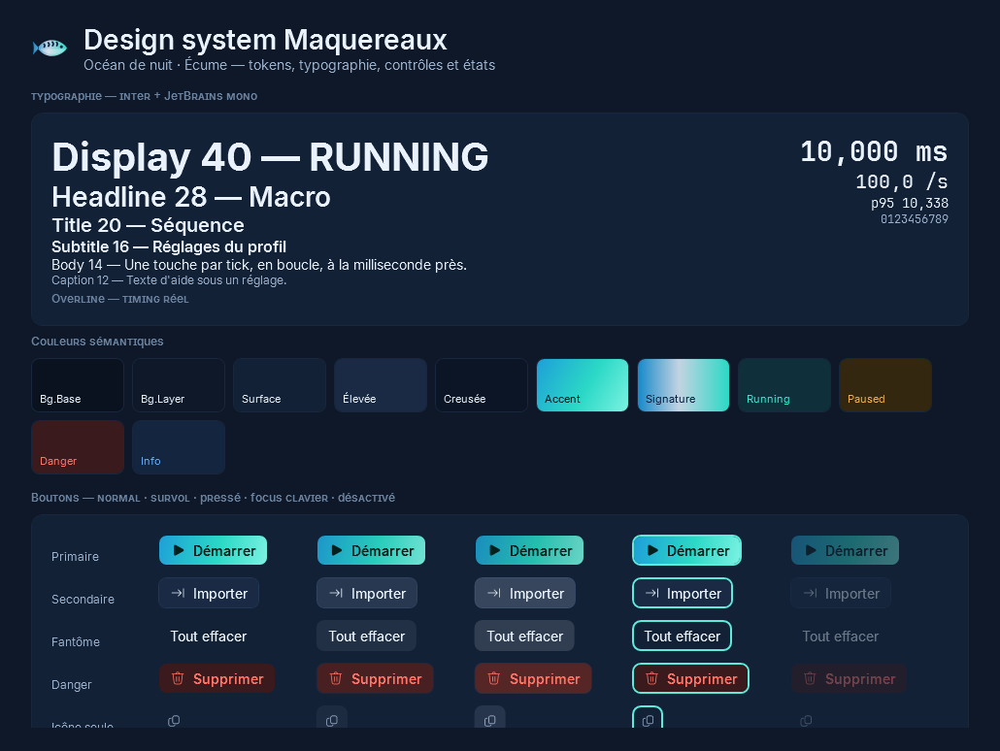
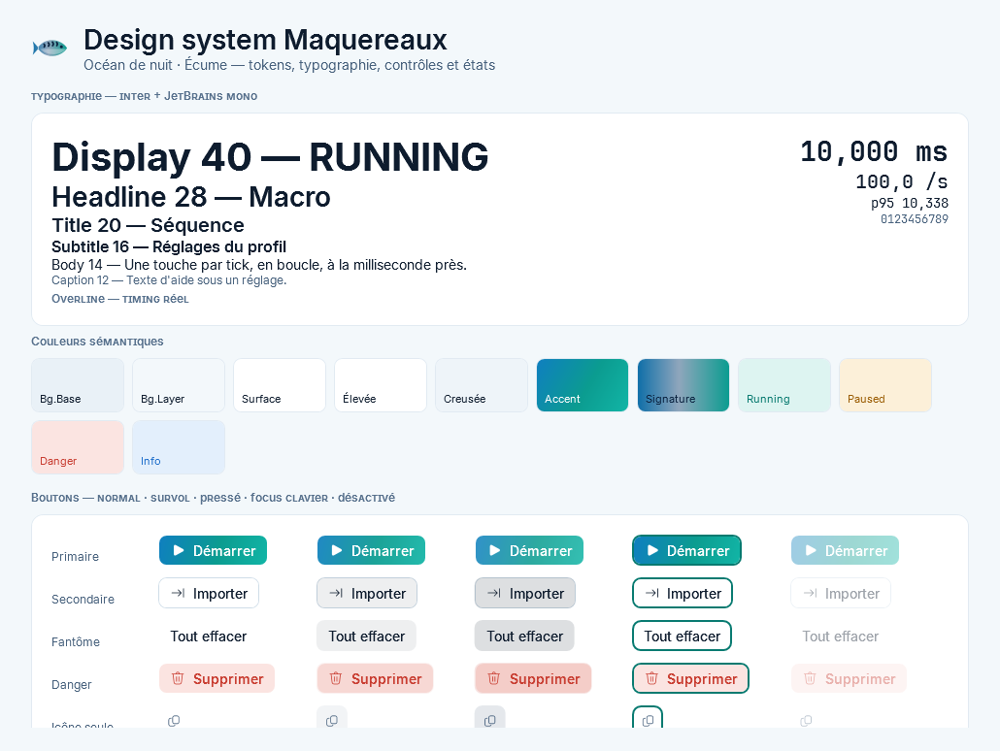

# Design system Maquereaux 🐟

> Identité « maquereau » : eaux profondes, reflets irisés, rayures discrètes. Sobre au repos, lumineux quand ça tourne.

Toutes les valeurs vivent dans `src/Maquereaux.App/Themes/`. **Aucune valeur en dur dans les vues** : on référence une clé
(`{DynamicResource …}` pour tout ce qui dépend du thème).

| Fichier | Contenu |
|---|---|
| `Dark.xaml` / `Light.xaml` | Palette (surfaces, textes, bordures, accent, états, graphiques). Remplacé à chaud au changement de thème. |
| `Tokens.xaml` | Polices, échelle typographique, espacements, rayons, tailles de contrôles, durées, ombres. |
| `Typography.xaml` | Styles de texte, chiffres monospace, cartes, badges, keycap `Kbd`, styles d'état. |
| `Icons.xaml` | 59 icônes Fluent (générées par `tools/gen_icons.py`). |
| `Logo.xaml` | Le maquereau (géométries + modèle `Logo`). |
| `Controls.xaml` / `Controls.Lists.xaml` | Tous les contrôles, dans tous leurs états. |

## Captures (générées par le smoke test en CI)

| Sombre | Clair |
|---|---|
|  |  |

## Couleurs

| Rôle | Sombre | Clair | Usage |
|---|---|---|---|
| `Bg.Base` | `#0A1220` | `#EEF4F8` | Fond de fenêtre (sous Mica) |
| `Surface` | `#132137` | `#FFFFFF` | Cartes |
| `Surface.Sunken` | — | — | Champs, pistes, zones creuses |
| `Accent` | `#2BD9C6` | `#0B9C90` | Action principale, focus, sélection |
| `State.Running` | `#33E8D0` | — | Macro en marche (avec halo) |
| `State.Paused` | `#F2B24A` | — | Pause automatique (fenêtre cible inactive) |
| `State.Danger` | `#FF7466` | — | Erreurs, REC, suppression |
| `Signature.Gradient` | `#1689C9 → #C3D3E2 → #2BD9C6` | idem assombri | **Avec parcimonie** : logo, bouton primaire, rayures |

Contraste : textes primaire et secondaire ≥ 4,5:1 sur `Surface` dans les deux thèmes (AA) ; le tertiaire est réservé
aux libellés non essentiels (chiffres d'index, unités).

## Typographie

| Style | Taille | Poids | Usage |
|---|---|---|---|
| `Text.Display` | 40 | Bold | Compte à rebours, très grands chiffres |
| `Text.Headline` | 28 | SemiBold | Titre de page, état de la carte héros |
| `Text.Title` | 20 | SemiBold | Titre de carte |
| `Text.Subtitle` | 16 | Medium | Sous-titres |
| `Text.Body` / `BodyStrong` / `Supporting` | 14 | Regular / SemiBold | Texte courant |
| `Text.Caption` / `Text.Overline` | 12 | Regular / SemiBold petites capitales | Aide, libellés de stats |
| `Num.Small` / `Num.Body` / `Num.Stat` / `Num.Hero` | 12 / 14 / 20 / 28 | — | **Tous les nombres qui bougent** (JetBrains Mono) |

Polices : **Inter** (UI) et **JetBrains Mono** (chiffres), embarquées, SIL OFL 1.1.

## Espacements, rayons, mouvement

- Grille de **4 px** : `Space.1` (4) → `Space.8` (32). Cartes : padding 20, écart entre cartes 16, page 32/24.
- Rayons : `Radius.S` 4 (keycap `Kbd`), `M` 8 (contrôles), `L` 12 (cartes), `XL` 16 (carte héros), `Pill`.
- Contrôles : hauteur 32 (40 en grand). Icônes 16 (20 en grand).
- Durées : 150 / 200 / 250 ms, ease-out cubique. Les animations décoratives (halo, pulsation, transitions) ne tournent que si
  Windows les autorise (`SystemParameters.ClientAreaAnimation`) **et** que la fenêtre est visible (`Services/Motion.cs`).
- Ombres : `Elevation.1` (menus), `Elevation.2` (toasts, popups), `Elevation.3` (dialogues).

## Contrôles

| Contrôle | Clé | États couverts |
|---|---|---|
| Bouton primaire | `Btn.Primary` | repos, survol, pressé, focus, désactivé |
| Bouton secondaire (défaut) | `Btn.Secondary` | idem |
| Bouton fantôme / danger | `Btn.Ghost` / `Btn.Danger` | idem |
| Bouton icône seule | `Btn.Icon` | idem — **toujours** ToolTip + `AutomationProperties.Name` |
| Puce / puce à bascule | `Btn.Chip` / `Chip.Toggle` | repos, survol, sélectionnée |
| Champ texte | `TextBox` implicite | placeholder (`Ui.Placeholder`), focus (soulignement accent), erreur (`Ui.HasError`) |
| Champ numérique | `c:NumericBox` | molette (avec focus), ↑↓, Maj ×10, unité, vide autorisé, flash d'erreur 1,2 s |
| Interrupteur | `Toggle` (CheckBox) | off, on, survol, focus, désactivé (bascule animée) |
| Contrôle segmenté | `Segmented` + `Segment` | sélectionné, survol, icône optionnelle |
| Curseur | `Slider` implicite | piste remplie à l'accent, pouce qui réagit au survol/glisser |
| Liste, navigation | `ListBoxItem`, `Nav.Item` | survol, sélection (barre accent), replié |
| Menus, info-bulles | implicites | élévation 1, coins 8 |

Les états « survol / pressé / focus » sont forçables (`Ui.ForceHover`, `Ui.ForcePressed`, `Ui.ForceFocus`) : c'est ce qui
permet à la galerie de les montrer tous côte à côte sur une capture statique.

## Règles

1. Une seule famille d'icônes (Fluent), pas d'emoji dans l'interface.
2. Le dégradé signature est rare : logo, bouton primaire, rayures de la carte héros.
3. Tout ce qui bouge en chiffres est en monospace tabulaire.
4. Dans un dictionnaire de thème, référence vers un autre dictionnaire = `DynamicResource` (vérifié par `tools/check_xaml.py`).
5. Une couleur d'état = un sens : turquoise = en marche, ambre = en pause, corail = erreur. Jamais décoratif.
