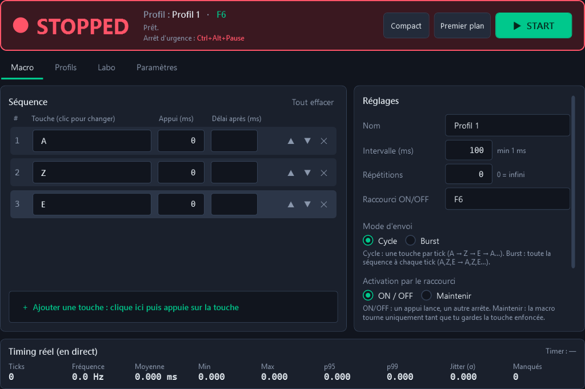
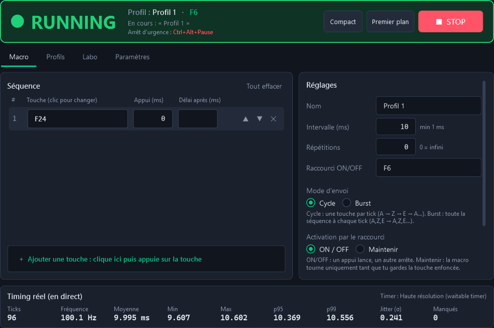

# 🔍 Audit UI/UX — Maquereaux v1.0.0 (jalon U0)

Base : captures du smoke test CI v1.0.0 (`docs/ui/before/`). Grille de critique : alignements, respiration,
contraste, cohérence des états, hiérarchie visuelle, parité clair/sombre.

| Macro (STOPPED) | Macro (RUNNING) |
|---|---|
|  |  |

## 1. Identité et direction artistique
| # | Défaut | Gravité |
|---|---|---|
| A1 | Aucune identité : palette gris-bleu « admin » générique, vert menthe standard ; rien n'évoque le maquereau | Haute |
| A2 | STOPPED affiché en **rouge vif** sur tout un bandeau : l'état normal « au repos » crie comme une erreur | Haute |
| A3 | L'accent (vert) sert à tout : START, focus, liens, raccourci, sélection → il ne signale plus rien | Moyenne |
| A4 | Police système (Segoe UI) + Cascadia/Consolas selon l'OS : rendu variable d'un PC à l'autre | Moyenne |
| A5 | Glyphes texte (▲ ▼ ✕ ⟳ ⤢ ●) en guise d'icônes : tailles et graisses incohérentes, pas d'icônes de navigation | Moyenne |
| A6 | Icône d'appli correcte en grand mais illisible en 16 px (le poisson devient une tache) | Basse |

## 2. Structure et navigation
| # | Défaut | Gravité |
|---|---|---|
| S1 | Bandeau d'état géant + onglets = l'écran est découpé en 3 bandes, aucune hiérarchie claire | Haute |
| S2 | Onglets texte sans icônes ; pas de navigation latérale ; « Compact » et « Premier plan » flottent dans le bandeau | Moyenne |
| S3 | Barre de titre Windows standard (blanche/grise selon le thème système) qui jure avec le thème sombre | Haute |
| S4 | Pas de taille de fenêtre responsive : colonnes fixes, panneau de stats 9 colonnes qui écrase les chiffres sous ~950 px | Moyenne |

## 3. Écran Macro
| # | Défaut | Gravité |
|---|---|---|
| M1 | La séquence est un **tableau de formulaires** (3 TextBox par ligne) : on ne « voit » pas une suite de touches | Haute |
| M2 | Réordonner = flèches ▲▼ uniquement, pas de glisser-déposer ni de raccourcis clavier | Moyenne |
| M3 | Colonne « Délai après » vide la plupart du temps, sans explication visible (tooltip seulement) | Moyenne |
| M4 | Intervalle = simple TextBox : pas de presets, pas d'équivalence en inputs/s | Moyenne |
| M5 | Panneau « Timing réel » à zéro quand la macro est arrêtée : 9 valeurs `0.000` = bruit visuel | Moyenne |
| M6 | Le START est loin de l'état (en haut à droite) ; rien ne relie visuellement « état » et « action » | Moyenne |
| M7 | Aucun conseil sur l'appui 0 ms (cause n°1 des « ça ne marche pas dans mon jeu ») | Moyenne |
| M8 | Radio Cycle/Burst et ON/OFF/Maintenir : radios classiques + gros paragraphe gris | Basse |

## 4. Profils, Labo, Paramètres
| # | Défaut | Gravité |
|---|---|---|
| P1 | Profils = lignes de liste, aucun aperçu de la séquence, actions texte toujours visibles (bruit) | Moyenne |
| P2 | Suppression par MessageBox Windows bloquante | Moyenne |
| P3 | Pas d'état vide designé (liste vide = écran noir) | Basse |
| P4 | Choix de la fenêtre cible : ComboBox de noms d'exe sans icône ni recherche | Basse |
| L1 | Labo : tableau de stats dense en police mono, sources difficiles à distinguer | Moyenne |
| L2 | Graphique : pas de ligne cible, pas d'info-bulle, pas de zoom, pas d'histogramme | Moyenne |
| L3 | Comparaison A/B : tableau brut sans verdict | Moyenne |
| L4 | REC = texte rouge, compte à rebours = chiffre dans une boîte, sans animation | Basse |
| R1 | Paramètres : une longue colonne de cartes, cases à cocher pour des ON/OFF (devraient être des interrupteurs) | Moyenne |
| R2 | Choix du timer en 3 radios avec jargon (« Thread.Sleep », « waitable timer ») | Moyenne |

## 5. Finitions
| # | Défaut | Gravité |
|---|---|---|
| F1 | Aucune animation (changement d'état, apparition des notifications) | Basse |
| F2 | Notifications empilées en bas, sans icône vectorielle ni action (Annuler…) | Moyenne |
| F3 | Focus clavier peu visible sur plusieurs contrôles, `AutomationProperties.Name` absents | Moyenne |
| F4 | Thème clair : correct mais plat ; surfaces et bordures peu contrastées | Basse |
| F5 | Mode compact = mini-bandeau rouge, pas d'opacité réglable, pas de double-clic pour rouvrir | Basse |
| F6 | Pas d'onboarding au premier lancement | Basse |

---

## 🗺️ Plan de refonte

| Jalon | Version | Réponses aux défauts |
|---|---|---|
| **U1** | 1.1.0 | Design system complet (tokens, typo Inter + JetBrains Mono embarquées, icônes Fluent vectorielles), tous les contrôles restylés (boutons ×5, NumericBox, ToggleSwitch, Segmented, Slider…), coque Win11 (WindowChrome, Mica, Snap Layouts), sidebar repliable, pastille d'état — A1-A5, S1-S3, R1 |
| **U2** | 1.2.0 | Macro : carte héros (état + action + sparkline), séquence en keycaps avec glisser-déposer et raccourcis, intervalle slider + presets + équivalence, conseil d'appui — M1-M8, S4 |
| **U3** | 1.3.0 | Profils en cartes + Annuler, états vides, sélecteur de process avec icônes et recherche, Paramètres par sections, toasts — P1-P4, R1-R2, F2 |
| **U4** | 1.4.0 | Labo : cartes de stats, graphique refait (cible, bande p95, info-bulle, zoom, histogramme), comparaison avec verdict, REC/compte à rebours animés — L1-L4 |
| **U5** | 1.5.0 | Pastille compacte, tray, onboarding, micro-animations, accessibilité, icône multi-résolution — A6, F1, F3-F6 |

Contrainte transversale : **zéro impact sur le timing** (stats rafraîchies à 10 Hz max, animations coupées fenêtre cachée,
benchmark CI comparé à la v1.0 à chaque jalon).
